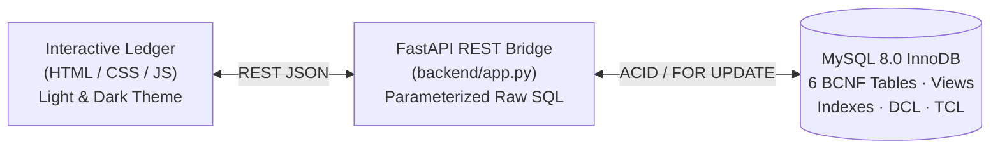
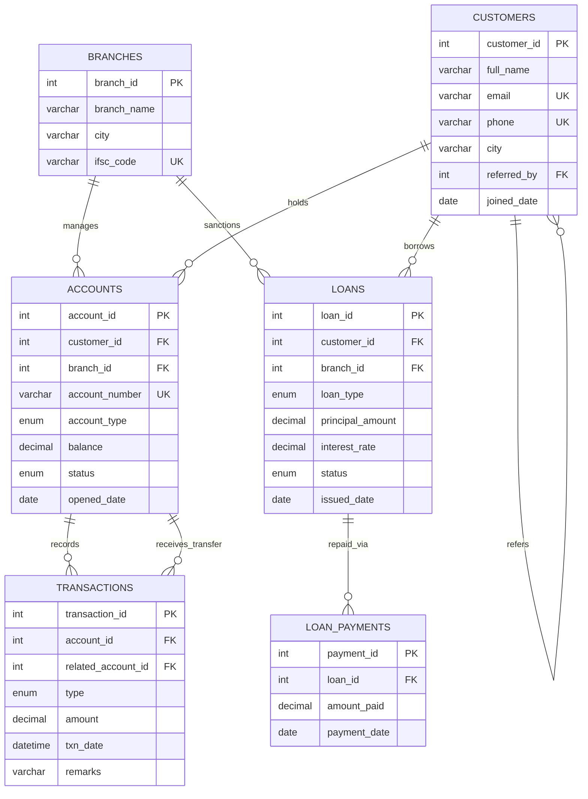
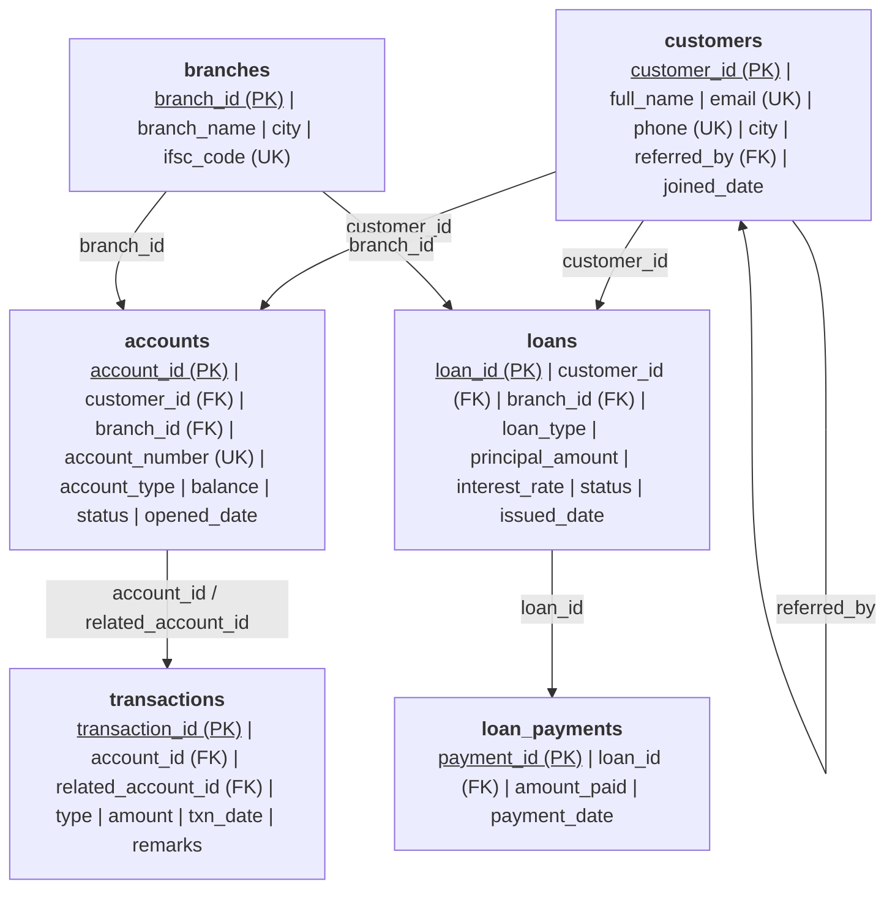

<h1 align="center">GareebSQL</h1> 

<p align="center">
  
  
  
  
</p>

**GareebSQL** is a relational banking and financial transaction management system built on **MySQL 8.0 (InnoDB)**, **Python FastAPI**, and an **HTML/CSS/JS frontend**. 

It eliminates ORM abstractions in favor of transparent, auditable raw SQL—demonstrating full normalization from **UNF to BCNF**, strict referential integrity, advanced analytical queries, role-based access control, and **ACID-compliant** fund transfers.

---

## Problem Statement & Scope
Traditional flat-file ledgers suffer from data redundancy, update anomalies, and race conditions during concurrent balance updates. **GareebSQL** solves these issues across core retail banking workflows:

- **Multi-Branch Customer & Account Management:** Supports Savings and Current accounts across multiple bank branches with domain-level `CHECK` and `UNIQUE` constraints.
- **Tamper-Proof Audit Trail:** Enforces `ON DELETE RESTRICT` across accounts, transactions, and loans so historical financial records cannot be orphaned.
- **Atomic Peer-to-Peer Transfers:** Uses row-level pessimistic locking (`SELECT ... FOR UPDATE`) inside explicit transaction blocks (`START TRANSACTION` / `COMMIT` / `ROLLBACK`) to prevent double-spending and negative balances.
- **Real-Time Financial Analytics:** Computes running account balances, customer wealth rankings, and monthly net cash flows directly inside MySQL using Window Functions and Common Table Expressions (CTEs).

---

## System Architecture & Data Flow



1. **Schema Layer (`sql/01_create_tables.sql`):** Defines 6 normalized relations with primary keys, foreign keys, `ENUM` domains, and `CHECK` constraints.
2. **Database Engine (`MySQL 8.0`):** Executes composite B-Tree indexes, read-only summary views, DCL user roles, window functions, CTEs, and ACID transactions.
3. **API Bridge (`backend/app.py`):** Exposes clean REST endpoints (`/api/dashboard`, `/api/statements`, `/api/analytics`, `/api/transfer`) executing raw SQL without an ORM.
4. **Client Interface (`frontend/`):** Minimalist dual-theme (Light/Dark) financial dashboard featuring live ledger views, running statements, and interactive transfer testing.

---

## Entity-Relationship Diagram

The conceptual model captures 6 core banking entities, including recursive customer referral tracking (`referred_by`) and dual account linkages (`account_id`, `related_account_id`) for peer-to-peer transfers.

**Full Entity & Cardinality Specification:** [`docs/ER_Diagram.md`](docs/ER_Diagram.md)



---

## Relational Design
The conceptual ER model translates into 6 relational tables enforced with **Primary Keys (`PK`)**, **Foreign Keys (`FK`)**, **Candidate Keys (`UK`)**, and **Domain `CHECK` Constraints** (`balance >= 0.00`, `amount > 0.00`) alongside `ON DELETE RESTRICT` referential rules to protect financial history.

**Detailed Table Schemas, Keys & Integrity Rules:** [`docs/Relational_Model.md`](docs/Relational_Model.md)



---

## Normalization
To eliminate insertion, update, and deletion anomalies, the database was systematically decomposed from a single Unnormalized Form (UNF) flat ledger up to **Boyce-Codd Normal Form (BCNF)**:

- **1NF (Atomic Values):** Flattened multi-valued transaction and EMI payment lists into separate atomic rows.
- **2NF (No Partial Dependencies):** Separated `loan_payments` from `loans` so loan metadata depends solely on `loan_id` rather than a composite `(loan_id, payment_id)` key.
- **3NF (No Transitive Dependencies):** Extracted `customers` and `branches` out of `accounts` so customer contact details and branch IFSC codes are stored once without duplication.
- **BCNF (Superkey Determinants):** Verified across all 6 relations (`branches`, `customers`, `accounts`, `transactions`, `loans`, `loan_payments`) that every non-trivial functional dependency determinant is a candidate key.

**Step-by-Step 1NF → 2NF → 3NF → BCNF Decomposition Proof:** [`docs/Normalization.md`](docs/Normalization.md)

---

## Topics Coverage

| Syllabus Component | Expected Implementation | Location in `GareebSQL` |
| :--- | :--- | :--- |
| **ER Model** | ER diagram with entities & relationships | [`docs/ER_Diagram.md`](docs/ER_Diagram.md) |
| **Relational Model** | Schema design with PKs & FKs | [`docs/Relational_Model.md`](docs/Relational_Model.md) |
| **Normalization** | Step-by-step 1NF, 2NF, 3NF & BCNF proof | [`docs/Normalization.md`](docs/Normalization.md) |
| **SQL Fundamentals** | DDL, DML, DCL & TCL | [`01_create_tables.sql`](sql/01_create_tables.sql), [`02_insert_data.sql`](sql/02_insert_data.sql), [`04_views_and_security.sql`](sql/04_views_and_security.sql) |
| **Complex Queries** | Inner, Outer & Self Joins | [`03_project_queries.sql`](sql/03_project_queries.sql) |
| **Subqueries** | Nested & Correlated subqueries | [`03_project_queries.sql`](sql/03_project_queries.sql) |
| **Set Operations** | `UNION`, `INTERSECT` & `EXCEPT` | [`03_project_queries.sql`](sql/03_project_queries.sql) |
| **Views & Indexing** | 2+ Views & Composite Indexes + `EXPLAIN` | [`04_views_and_security.sql`](sql/04_views_and_security.sql) |
| **Advanced SQL** | Window Functions (`SUM() OVER`, `DENSE_RANK()`) & CTEs | [`03_project_queries.sql`](sql/03_project_queries.sql) |

---

## Repository Structure

```text
GareebSQL/
├── docs/
│   ├── ER_Diagram.md              # Mermaid ER diagram & cardinality rules
│   ├── Relational_Model.md        # PK, FK, Candidate Key & domain constraints
│   └── Normalization.md           # Step-by-step 1NF → 2NF → 3NF → BCNF proof
├── sql/
│   ├── screenshots/               # Verified terminal output screenshots
│   ├── 01_create_tables.sql       # DDL: Schema, keys & CHECK constraints
│   ├── 02_insert_data.sql         # DML: Sample data, UPDATE & DELETE
│   ├── 03_project_queries.sql     # Joins, Subqueries, Set Ops, Window Functions & CTEs
│   ├── 04_views_and_security.sql  # Views, Indexes + EXPLAIN, DCL & TCL
│   └── README.md                  # Sequential SQL execution & screenshot log
├── backend/
│   ├── app.py                     # FastAPI REST API executing raw SQL
│   └── requirements.txt           # Python dependencies
├── frontend/
│   ├── index.html                 # 5-tab interactive ledger interface
│   ├── style.css                  # Dual-theme (Light/Dark) Swiss-ledger styles
│   └── app.js                     # Live API bindings & theme persistence
└── README.md
```

---

## Local Setup & Execution Guide

### 1. Initialize the MySQL 8.0 Database
Run all four SQL scripts sequentially from the repository root (see [`sql/README.md`](sql/README.md) for terminal output proofs):

```powershell
mysql -u root -p < sql/01_create_tables.sql
mysql -u root -p < sql/02_insert_data.sql
mysql -u root -p -t < sql/03_project_queries.sql
mysql -u root -p -t < sql/04_views_and_security.sql
```

### 2. Configure Environment & Python Virtual Environment
Create a `.env` file in the root `GareebSQL/` folder:

```env
DB_HOST=localhost
DB_PORT=3306
DB_USER=root
DB_PASSWORD=your_mysql_password
DB_NAME=gareeb_sql
```

Set up the isolated virtual environment inside `backend/`:

```powershell
cd backend
python -m venv .venv
.\.venv\Scripts\Activate.ps1
pip install --only-binary=:all: -r requirements.txt
cd ..
```

### 3. Launch the Application
From the root `GareebSQL/` directory:

```powershell
uvicorn backend.app:app --reload
```

Open **`http://127.0.0.1:8000`** in your browser (Swagger API docs available at `http://127.0.0.1:8000/docs`).

---

Made by Prabhat Bhatia | DBMS Capstone Project