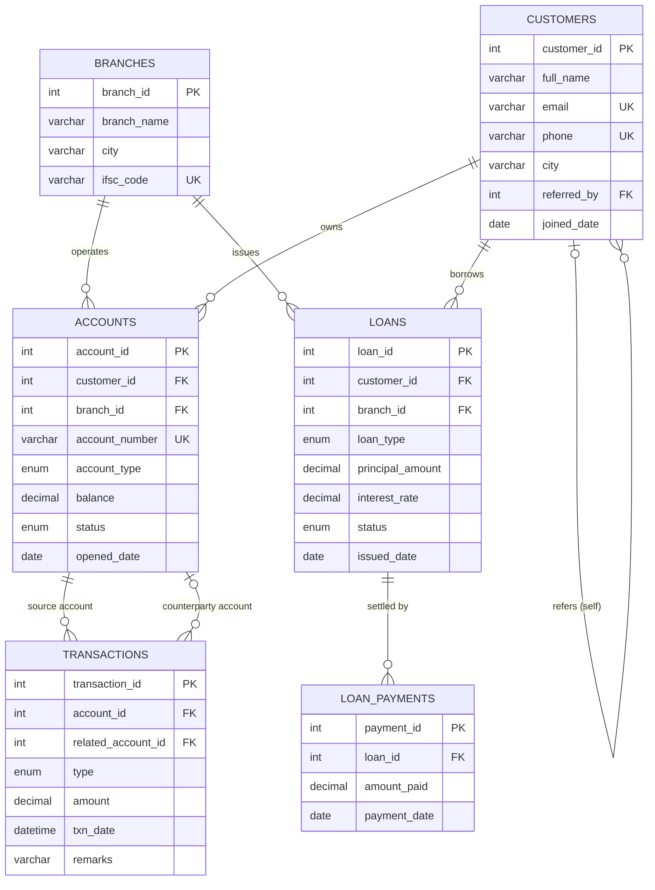

# GareebSQL: DBMS Viva Master Examination Guide & Technical Blueprint
**Project:** GareebSQL — High-Integrity Relational Banking Ledger & ACID Transaction Engine  
**Author:** Prabhat Bhatia & Team  
**Database System:** MySQL 8.0 (InnoDB Engine, Strict Foreign Key & Domain Integrity)  
**Application Architecture:** Vanilla Modern Frontend (Swiss Ledger UI) $\longleftrightarrow$ FastAPI Backend (Raw SQL & Parameterized Queries) $\longleftrightarrow$ MySQL Database  
**Target Purpose:** Complete Technical Defense & Viva Examination Reference for Database Management Systems (DBMS)

---

## Table of Contents
1. [Project Overview & Architectural Design](#1-project-overview--architectural-design)
2. [Database Normalization Blueprint (UNF $\to$ 1NF $\to$ 2NF $\to$ 3NF $\to$ BCNF)](#2-database-normalization-blueprint-unf-to-bcnf)
   - 2.1 The Starting Point: Unnormalized Form (UNF) & Real-World Anomalies
   - 2.2 First Normal Form (1NF): Atomicity & Key Establishment
   - 2.3 Second Normal Form (2NF): Elimination of Partial Functional Dependencies
   - 2.4 Third Normal Form (3NF): Elimination of Transitive Dependencies
   - 2.5 Boyce-Codd Normal Form (BCNF): Rigorous Superkey Determinant Proofs
   - 2.6 Normalization Summary Matrix
3. [Relational Schema & Entity-Relationship (ER) Architecture](#3-relational-schema--entity-relationship-er-architecture)
   - 3.1 Entity-Relationship (ER) Diagram (Crow's Foot Notation)
   - 3.2 Relational Schema & Integrity Constraints Table
   - 3.3 Foreign Key Rules & Referential Action Rationale
4. [Complete SQL Implementation Breakdown with Queries, Diagrams & Outputs](#4-complete-sql-implementation-breakdown)
   - 4.1 Data Definition Language (DDL): `01_create_tables.sql`
   - 4.2 Data Manipulation Language (DML): `02_insert_data.sql`
   - 4.3 Advanced Project Queries: `03_project_queries.sql`
     - Query 1: 4-Table Inner Join (Consolidated Account Ledger)
     - Query 2: Left Outer Join Anti-Pattern (Debt-Free Customer Audit)
     - Query 3: Self-Join (Hierarchical Referral Tree)
     - Query 4: Double Self-Join (Inter-Account Fund Transfer Reconciliation)
     - Query 5: Independent Subquery with Set Filter (High-Value Loan Risk)
     - Query 6: Correlated Subquery (Above-Branch-Average Balance Filter)
     - Query 7: Relational Set Operations (`UNION`, `INTERSECT`, `EXCEPT`)
     - Query 8: Window Function (Real-Time Cumulative Running Balance)
     - Query 9: Window Function (Dense Wealth Ranking)
     - Query 10: Common Table Expression (CTE) (Multi-Tier Cash Flow Analysis)
   - 4.4 Views, Indexing, Security (DCL) & Transaction Control (TCL): `04_views_and_security.sql`
     - Database Views (Abstraction & Aggregation)
     - Composite B-Tree Index Optimization & `EXPLAIN` Cost Proof
     - Data Control Language (DCL): Role-Based Access Control (RBAC)
     - Transaction Control Language (TCL): Atomic Multi-Row Fund Transfer
5. [Frontend & Backend System Working Flow](#5-frontend--backend-system-working-flow)
   - 5.1 Architecture & Why Raw SQL Over ORM
   - 5.2 FastAPI REST API Endpoints & Request/Response Contracts
   - 5.3 Complete ACID Transfer Lifecycle (Data Flow Diagram)
   - 5.4 Frontend Architecture & UI Features (The 5 Core Tabs)
6. [How to Run, Test, and Demonstrate the Project](#6-how-to-run-test-and-demonstrate-the-project)
   - 6.1 Prerequisites & Installation on Windows
   - 6.2 Database Initialization & Verification
   - 6.3 Backend Server Launch & UI Access
   - 6.4 The 3-Minute Live Viva Demo Script
7. [Comprehensive DBMS Viva Q&A (30+ High-Yield Questions & Answers)](#7-comprehensive-dbms-viva-qa-master-sheet)

---

# 1. Project Overview & Architectural Design

### What is GareebSQL?
**GareebSQL** is an enterprise-grade banking ledger and financial ledger management system designed strictly from foundational Database Management System (DBMS) principles. Unlike typical toy CRUD projects that rely heavily on Object-Relational Mapping (ORM) frameworks to obscure database interactions, GareebSQL executes **100% pure parameterized SQL** against an enterprise **MySQL 8.0** engine backed by **InnoDB**.

### Core DBMS Themes Proven in this Project:
1. **Mathematical Normalization to BCNF:** Ensuring zero update, deletion, or insertion anomalies across multi-branch, multi-account banking operations.
2. **ACID Transaction Guarantee:** Explicit row-level pessimistic locking (`SELECT ... FOR UPDATE`), transactional isolation, atomicity via `START TRANSACTION`, `SAVEPOINT`, and `COMMIT`/`ROLLBACK`.
3. **Advanced SQL Constructs:** Window Functions (`SUM() OVER`, `DENSE_RANK()`), Common Table Expressions (CTEs), Recursive/Self Joins, Correlated Subqueries, and Relational Set Theory (`UNION`, `INTERSECT`, `EXCEPT`).
4. **Performance Engineering:** Composite B-Tree indexing evaluated using MySQL execution plans (`EXPLAIN FORMAT=TREE`).
5. **Security & Governance:** Principle of Least Privilege via Data Control Language (`GRANT`, `REVOKE`, Role Segregation) and domain-level integrity constraints (`CHECK`, `ENUM`, `UNIQUE`).

```
+-----------------------------------------------------------------------------------+
|                              GAREEBSQL ARCHITECTURE                               |
+-----------------------------------------------------------------------------------+
|  [ FRONTEND - Swiss Ledger UI ]                                                   |
|  * Plain HTML5 / Modern CSS Variables (Dark & Light Ledger) / Native Fetch API    |
|  * 5 Real-Time Modules: Ledger, ACID Transfer, Statements, CTE Analytics, Flow   |
+------------------------------------------^----------------------------------------+
                                           | HTTP / JSON REST Calls
+------------------------------------------v----------------------------------------+
|  [ BACKEND - FastAPI Execution Engine ]                                           |
|  * Raw Parameterized SQL Queries (Zero ORM Overhead)                              |
|  * Strict Input Validation (Pydantic Models)                                      |
|  * Explicit Transaction Lifecycle Management (conn.start_transaction, commit)    |
+------------------------------------------^----------------------------------------+
                                           | TCP Socket (mysql.connector)
+------------------------------------------v----------------------------------------+
|  [ DATABASE - MySQL 8.0 InnoDB Storage Engine ]                                   |
|  * 6 Normalized BCNF Relations (branches, customers, accounts, txns, loans, pays)|
|  * Strict Referential Integrity (ON DELETE RESTRICT / SET NULL)                   |
|  * B-Tree Indexes, Abstract Database Views, Role-Based Access Control (DCL)       |
+-----------------------------------------------------------------------------------+
```

---

# 2. Database Normalization Blueprint (UNF to BCNF)

Normalization is the formal mathematical process of organizing fields and tables of a relational database to minimize redundancy and eliminate operational anomalies (Insertion, Update, and Deletion).

```
UNF (Unnormalized Spreadsheet)
  │  Rule: Eliminate repeating groups & multi-valued columns; establish atomic cells.
  ▼
1NF (First Normal Form)
  │  Rule: Eliminate partial functional dependencies on composite candidate keys.
  ▼
2NF (Second Normal Form)
  │  Rule: Eliminate transitive functional dependencies (non-key -> non-key).
  ▼
3NF (Third Normal Form)
  │  Rule: For every functional dependency X -> Y, X must be a superkey.
  ▼
BCNF (Boyce-Codd Normal Form) [FINAL ARCHITECTURE: 6 INDEPENDENT RELATIONS]
```

---

### 2.1 The Starting Point: Unnormalized Form (UNF) & Real-World Anomalies

In an unnormalized state, a naive banking system might attempt to store all branch, customer, account, transaction, loan, and installment records inside a single flat tabular structure:

#### Flat Spreadsheet Schema:
`BankingSheet(customer_id, full_name, email, phone, city, branch_name, ifsc_code, account_number, account_type, balance, txn_ids, txn_amounts, loan_id, principal_amount, interest_rate, payment_ids, payment_amounts)`

#### UNF Data Sample:
| customer_id | full_name | branch_name | ifsc_code | account_number | balance | txn_ids | txn_amounts | loan_id | principal | payment_ids |
|:---|:---|:---|:---|:---|:---|:---|:---|:---|:---|:---|
| 1 | Rahul Verma | Main Branch | GRBS0001 | ACC1001, ACC1002 | 50000, 120000 | T1, T2 | 60000, 10000 | L1 | 500000 | P1, P2 |
| 2 | Priya Sharma| Main Branch | GRBS0001 | ACC1003 | 35000 | T3, T4 | 30000, 5000 | L3 | 100000 | P4 |

#### The Three Catastrophic Anomalies of UNF:
1. **Insertion Anomaly:**
   - A bank creates a new regional branch (e.g., `City Center, Gurugram, GRBS0002`). The database cannot record this branch because no customer has opened an account there yet. The primary key attributes would be `NULL`, which violates entity integrity.
2. **Update Anomaly:**
   - If the IFSC code of the `Main Branch` changes from `GRBS0001` to `GRBS0099`, an administrator must update every individual customer and account row in the database. If even one record fails to update, the database enters an inconsistent, corrupted state.
3. **Deletion Anomaly:**
   - If customer Rahul Verma closes his account and is removed from the system, the branch information (`Main Branch`, `GRBS0001`) and his historical loan records are simultaneously obliterated from the system forever.

---

### 2.2 First Normal Form (1NF): Atomicity & Key Establishment

#### The 1NF Rule:
A relation is in **1NF** if and only if:
1. Every attribute domain contains only **atomic (indivisible) values**.
2. There are **no repeating groups** or multi-valued attributes in any cell.
3. A distinct **Primary Key** is identified for each relation.

#### The Transformation:
We flatten repeating lists of transactions and loan payments by breaking the giant sheet into three preliminary tables with distinct rows:

1. **`CustomerAccounts`**
   - **Attributes:** `customer_id`, `full_name`, `email`, `phone`, `city`, `referred_by`, `branch_id`, `branch_name`, `ifsc_code`, `account_number`, `account_type`, `balance`, `status`, `opened_date`
   - **Primary Key:** `account_number`
2. **`Transactions`**
   - **Attributes:** `transaction_id`, `account_number`, `related_account_number`, `type`, `amount`, `txn_date`, `remarks`
   - **Primary Key:** `transaction_id`
3. **`CustomerLoans`**
   - **Attributes:** `loan_id`, `payment_id`, `customer_id`, `branch_id`, `loan_type`, `principal_amount`, `interest_rate`, `status`, `issued_date`, `amount_paid`, `payment_date`
   - **Composite Primary Key:** `(loan_id, payment_id)`

#### 1NF Compliance Verification:
- All comma-separated values (`T1, T2`, `P1, P2`) are eliminated.
- Every intersection of row and column contains exactly one scalar value.

---

### 2.3 Second Normal Form (2NF): Elimination of Partial Functional Dependencies

#### The 2NF Rule:
A relation is in **2NF** if and only if:
1. It is already in **1NF**.
2. **No non-prime attribute is partially dependent on any candidate key.** (Every non-key attribute must depend on the *whole* primary key, not a proper subset of it).
> *Note:* If a table's primary key consists of only a single column, it is automatically in 2NF. 2NF issues only arise when candidate keys are composite.

#### Analysis of `CustomerLoans`:
In table `CustomerLoans`, the primary key is composite: `(loan_id, payment_id)`.
Let us analyze the Functional Dependencies (FDs):
- `(loan_id, payment_id)` $\longrightarrow$ `amount_paid`, `payment_date` (Full Functional Dependency)
- `loan_id` $\longrightarrow$ `customer_id`, `branch_id`, `loan_type`, `principal_amount`, `interest_rate`, `status`, `issued_date` (**Partial Functional Dependency!**)

Because attributes like `principal_amount` and `interest_rate` depend solely on `loan_id` and have nothing to do with `payment_id`, storing them together causes severe duplication: every time an EMI installment (`payment_id`) is logged, the loan's entire principal, interest rate, and terms are redundantly re-stored!

#### Decomposition into 2NF:
We decompose `CustomerLoans` into two separate relations:

```
[CustomerLoans] (1NF, Composite PK)
       │
       ├───► Loans (PK: loan_id)
       │     Columns: loan_id, customer_id, branch_id, loan_type, principal_amount, 
       │              interest_rate, status, issued_date
       │
       └───► LoanPayments (PK: payment_id, FK: loan_id)
             Columns: payment_id, loan_id, amount_paid, payment_date
```

**Result:** Both `Loans` and `LoanPayments` have single-attribute primary keys (`loan_id` and `payment_id`), completely eliminating partial functional dependency.

---

### 2.4 Third Normal Form (3NF): Elimination of Transitive Dependencies

#### The 3NF Rule:
A relation is in **3NF** if and only if:
1. It is in **2NF**.
2. **No non-prime attribute is transitively dependent on the primary key.**
Formal definition: For every non-trivial functional dependency $X \longrightarrow Y$, either:
- $X$ is a Superkey, OR
- $Y$ is a Prime Attribute (member of a candidate key).
Informal summary: *"Every non-key attribute must provide a fact about the key, the whole key, and nothing but the key (so help me Codd)."*

#### Analysis of `CustomerAccounts`:
In `CustomerAccounts`, the primary key is `account_number` (or surrogate `account_id`).
Let us map the functional dependencies:
1. `account_number` $\longrightarrow$ `customer_id`, `branch_id`, `account_type`, `balance`, `status`
2. `customer_id` $\longrightarrow$ `full_name`, `email`, `phone`, `city`, `referred_by`
3. `branch_id` $\longrightarrow$ `branch_name`, `city`, `ifsc_code`

Notice the transitive chains:
$$\text{account\_number} \longrightarrow \text{customer\_id} \longrightarrow \text{full\_name, email, phone}$$
$$\text{account\_number} \longrightarrow \text{branch\_id} \longrightarrow \text{branch\_name, ifsc\_code}$$

Because `customer_id` and `branch_id` are NOT candidate keys of `CustomerAccounts`, attributes like `full_name` and `branch_name` are non-key attributes transitively dependent on `account_number`.
- **Consequence:** If customer Rahul Verma has three bank accounts (Savings, Current, Fixed Deposit), his name, email, and phone number are duplicated three times. If he changes his phone number, we risk an update anomaly.

#### Decomposition into 3NF:
We decouple the transitive chains by isolating the entities into dedicated relations:
1. **`customers`** (`customer_id` [PK], `full_name`, `email`, `phone`, `city`, `referred_by`, `joined_date`)
2. **`branches`** (`branch_id` [PK], `branch_name`, `city`, `ifsc_code`)
3. **`accounts`** (`account_id` [PK], `customer_id` [FK], `branch_id` [FK], `account_number`, `account_type`, `balance`, `status`, `opened_date`)

---

### 2.5 Boyce-Codd Normal Form (BCNF): Rigorous Superkey Determinant Proofs

#### The BCNF Rule:
A relation is in **BCNF** (also known as 3.5NF) if and only if:
**For every non-trivial functional dependency $X \longrightarrow Y$, the determinant $X$ MUST be a Superkey.**
BCNF is strictly stronger than 3NF because it removes the second clause of 3NF (which allowed $Y$ to be a prime attribute when $X$ was not a superkey).

#### Formal Verification Across All 6 GareebSQL Tables:

| Relation Name | Functional Dependencies ($X \longrightarrow Y$) | Is $X$ a Superkey / Candidate Key? | BCNF Compliant? |
|:---|:---|:---:|:---:|
| **`branches`** | `branch_id` $\longrightarrow$ `branch_name, city, ifsc_code`<br>`ifsc_code` $\longrightarrow$ `branch_id, branch_name, city` | **YES** (`branch_id` is PK)<br>**YES** (`ifsc_code` is UNIQUE) | **PASSED (BCNF)** |
| **`customers`** | `customer_id` $\longrightarrow$ `full_name, email, phone, city, referred_by, joined_date`<br>`email` $\longrightarrow$ all other attributes<br>`phone` $\longrightarrow$ all other attributes | **YES** (`customer_id` is PK)<br>**YES** (`email` is UNIQUE)<br>**YES** (`phone` is UNIQUE) | **PASSED (BCNF)** |
| **`accounts`** | `account_id` $\longrightarrow$ all attributes<br>`account_number` $\longrightarrow$ all attributes | **YES** (`account_id` is PK)<br>**YES** (`account_number` is UNIQUE) | **PASSED (BCNF)** |
| **`transactions`** | `transaction_id` $\longrightarrow$ `account_id, related_account_id, type, amount, txn_date, remarks` | **YES** (`transaction_id` is PK) | **PASSED (BCNF)** |
| **`loans`** | `loan_id` $\longrightarrow$ `customer_id, branch_id, loan_type, principal_amount, interest_rate, status, issued_date` | **YES** (`loan_id` is PK) | **PASSED (BCNF)** |
| **`loan_payments`**| `payment_id` $\longrightarrow$ `loan_id, amount_paid, payment_date` | **YES** (`payment_id` is PK) | **PASSED (BCNF)** |

**Conclusion:** In every single functional dependency across all six relations, the determinant on the left-hand side ($X$) is a valid Candidate Key. Therefore, **GareebSQL is mathematically guaranteed to be in Boyce-Codd Normal Form (BCNF)**.

---

### 2.6 Normalization Summary Matrix

| Form | Invalidation Condition | GareebSQL Remediation | Anomalies Solved |
|:---|:---|:---|:---|
| **UNF** | Repeating lists, non-atomic values | Split arrays into individual rows | Inability to query scalar values |
| **1NF** | Composite multi-valued structures | Extracted `transactions` and `payments` | Cell-level parsing errors |
| **2NF** | Non-key depends on subset of composite PK | Split `CustomerLoans` into `loans` & `loan_payments` | Loan detail repetition per payment |
| **3NF** | Non-key depends on non-key ($X \to Y \to Z$) | Split `CustomerAccounts` into `customers`, `branches`, `accounts` | Customer & branch duplication |
| **BCNF** | Any determinant is not a superkey | Ensured all determinants (`email`, `phone`, `account_no`, `ifsc`) are UNIQUE candidate keys | Hidden key overlap redundancy |

---

# 3. Relational Schema & Entity-Relationship (ER) Architecture

### 3.1 Entity-Relationship (ER) Diagram (Crow's Foot Notation)



---

### 3.2 Relational Schema & Integrity Constraints Table

```
1. branches      ( branch_id [PK], branch_name, city, ifsc_code [UK] )
2. customers     ( customer_id [PK], full_name, email [UK], phone [UK], city, 
                   referred_by [FK -> customers.customer_id], joined_date )
3. accounts      ( account_id [PK], customer_id [FK -> customers.customer_id], 
                   branch_id [FK -> branches.branch_id], account_number [UK], 
                   account_type, balance, status, opened_date )
4. transactions  ( transaction_id [PK], account_id [FK -> accounts.account_id], 
                   related_account_id [FK -> accounts.account_id], type, amount, 
                   txn_date, remarks )
5. loans         ( loan_id [PK], customer_id [FK -> customers.customer_id], 
                   branch_id [FK -> branches.branch_id], loan_type, principal_amount, 
                   interest_rate, status, issued_date )
6. loan_payments ( payment_id [PK], loan_id [FK -> loans.loan_id], amount_paid, payment_date )
```

#### Detailed Column Constraints & Types:

| Table | Attribute | SQL Data Type | Key / Integrity Constraints | Business Rule Enforced |
|:---|:---|:---|:---|:---|
| **branches** | `branch_id` | `INT AUTO_INCREMENT` | `PRIMARY KEY` | Unique branch identifier |
| | `ifsc_code` | `VARCHAR(15)` | `NOT NULL UNIQUE` | Indian Financial System Code uniqueness |
| **customers**| `customer_id` | `INT AUTO_INCREMENT` | `PRIMARY KEY` | Unique customer identity |
| | `email` | `VARCHAR(120)` | `NOT NULL UNIQUE, CHECK (email LIKE '%_@__%.__%')` | Standard RFC email formatting constraint |
| | `phone` | `VARCHAR(15)` | `NOT NULL UNIQUE` | Telecommunication uniqueness |
| | `referred_by` | `INT NULL` | `FOREIGN KEY REFERENCES customers(customer_id) ON DELETE SET NULL` | Referral tracking; if referrer deletes account, referral chain remains intact |
| **accounts** | `account_id` | `INT AUTO_INCREMENT` | `PRIMARY KEY` | Surrogate account identifier |
| | `account_number` | `VARCHAR(20)` | `NOT NULL UNIQUE` | User-facing bank account number |
| | `account_type` | `ENUM('Savings', 'Current')`| `NOT NULL DEFAULT 'Savings'` | Restricts account taxonomy |
| | `balance` | `DECIMAL(12, 2)` | `NOT NULL DEFAULT 0.00, CHECK (balance >= 0.00)` | Prevents negative account balances at engine level |
| | `status` | `ENUM('Active', 'Frozen', 'Closed')` | `NOT NULL DEFAULT 'Active'` | Operational state control |
| **transactions** | `transaction_id` | `INT AUTO_INCREMENT` | `PRIMARY KEY` | Transaction audit identifier |
| | `amount` | `DECIMAL(12, 2)` | `NOT NULL, CHECK (amount > 0.00)` | Financial amounts must be strictly positive |
| | `type` | `ENUM('Deposit', 'Withdrawal', 'Transfer_Out', 'Transfer_In')` | `NOT NULL` | Double-entry accounting categorizer |
| **loans** | `principal_amount`| `DECIMAL(12, 2)` | `NOT NULL, CHECK (principal_amount > 0.00)` | Loan capital constraint |
| | `interest_rate` | `DECIMAL(5, 2)` | `NOT NULL, CHECK (interest_rate > 0.00 AND interest_rate <= 30.00)` | Prevents usurious or erroneous interest rates |
| **loan_payments**| `amount_paid` | `DECIMAL(12, 2)` | `NOT NULL, CHECK (amount_paid > 0.00)` | Payment integrity constraint |

---

### 3.3 Foreign Key Rules & Referential Action Rationale

In relational engineering, choosing between `CASCADE`, `RESTRICT`, and `SET NULL` is critical for legal, financial, and audit compliance:

1. **`ON DELETE RESTRICT` for Financial Entities:**
   - Applied to: `accounts.customer_id`, `accounts.branch_id`, `transactions.account_id`, `loans.customer_id`, `loan_payments.loan_id`.
   - **Rationale:** A bank cannot legally delete a customer record if that customer has open accounts, historical transactions, or unpaid loans. Attempting to execute `DELETE FROM customers WHERE customer_id = 1` will throw MySQL Error 1451, guaranteeing complete audit trail immutability.
2. **`ON DELETE SET NULL` for Optional Links:**
   - Applied to: `customers.referred_by` and `transactions.related_account_id`.
   - **Rationale:** If a customer who referred other users leaves the bank, their referred friends should still exist. The `referred_by` pointer is gracefully set to `NULL` without cascading deletions. Similarly, if a counterparty account is archived, the source transaction log remains historically intact.

---

# 4. Complete SQL Implementation Breakdown

All SQL code in GareebSQL is organized into 4 cleanly segregated scripts under the `/sql` directory.

---

### 4.1 Data Definition Language (DDL): `01_create_tables.sql`

```sql
DROP DATABASE IF EXISTS gareeb_sql;
CREATE DATABASE gareeb_sql;
USE gareeb_sql;

CREATE TABLE branches (
    branch_id INT AUTO_INCREMENT PRIMARY KEY,
    branch_name VARCHAR(100) NOT NULL,
    city VARCHAR(60) NOT NULL,
    ifsc_code VARCHAR(15) NOT NULL UNIQUE
);

CREATE TABLE customers (
    customer_id INT AUTO_INCREMENT PRIMARY KEY,
    full_name VARCHAR(100) NOT NULL,
    email VARCHAR(120) NOT NULL UNIQUE,
    phone VARCHAR(15) NOT NULL UNIQUE,
    city VARCHAR(60) NOT NULL,
    referred_by INT NULL,
    joined_date DATE NOT NULL,
    FOREIGN KEY (referred_by) REFERENCES customers(customer_id) ON DELETE SET NULL,
    CHECK (email LIKE '%_@__%.__%')
);

CREATE TABLE accounts (
    account_id INT AUTO_INCREMENT PRIMARY KEY,
    customer_id INT NOT NULL,
    branch_id INT NOT NULL,
    account_number VARCHAR(20) NOT NULL UNIQUE,
    account_type ENUM('Savings', 'Current') NOT NULL DEFAULT 'Savings',
    balance DECIMAL(12, 2) NOT NULL DEFAULT 0.00,
    status ENUM('Active', 'Frozen', 'Closed') NOT NULL DEFAULT 'Active',
    opened_date DATE NOT NULL,
    FOREIGN KEY (customer_id) REFERENCES customers(customer_id) ON DELETE RESTRICT,
    FOREIGN KEY (branch_id) REFERENCES branches(branch_id) ON DELETE RESTRICT,
    CHECK (balance >= 0.00)
);

CREATE TABLE transactions (
    transaction_id INT AUTO_INCREMENT PRIMARY KEY,
    account_id INT NOT NULL,
    related_account_id INT NULL,
    type ENUM('Deposit', 'Withdrawal', 'Transfer_Out', 'Transfer_In') NOT NULL,
    amount DECIMAL(12, 2) NOT NULL,
    txn_date DATETIME NOT NULL DEFAULT CURRENT_TIMESTAMP,
    remarks VARCHAR(255) NULL,
    FOREIGN KEY (account_id) REFERENCES accounts(account_id) ON DELETE RESTRICT,
    FOREIGN KEY (related_account_id) REFERENCES accounts(account_id) ON DELETE SET NULL,
    CHECK (amount > 0.00)
);

CREATE TABLE loans (
    loan_id INT AUTO_INCREMENT PRIMARY KEY,
    customer_id INT NOT NULL,
    branch_id INT NOT NULL,
    loan_type ENUM('Home', 'Personal', 'Education', 'Vehicle') NOT NULL,
    principal_amount DECIMAL(12, 2) NOT NULL,
    interest_rate DECIMAL(5, 2) NOT NULL,
    status ENUM('Pending', 'Active', 'Closed', 'Rejected') NOT NULL DEFAULT 'Pending',
    issued_date DATE NOT NULL,
    FOREIGN KEY (customer_id) REFERENCES customers(customer_id) ON DELETE RESTRICT,
    FOREIGN KEY (branch_id) REFERENCES branches(branch_id) ON DELETE RESTRICT,
    CHECK (principal_amount > 0.00),
    CHECK (interest_rate > 0.00 AND interest_rate <= 30.00)
);

CREATE TABLE loan_payments (
    payment_id INT AUTO_INCREMENT PRIMARY KEY,
    loan_id INT NOT NULL,
    amount_paid DECIMAL(12, 2) NOT NULL,
    payment_date DATE NOT NULL,
    FOREIGN KEY (loan_id) REFERENCES loans(loan_id) ON DELETE RESTRICT,
    CHECK (amount_paid > 0.00)
);
```

#### DDL Viva Questions Addressed:
- **Why use `DECIMAL(12, 2)` instead of `FLOAT` or `DOUBLE`?**
  *Answer:* `FLOAT` and `DOUBLE` use IEEE-754 binary floating-point representation, which causes rounding precision errors (e.g., $0.1 + 0.2 = 0.30000000000000004$). `DECIMAL` is stored as an exact fixed-point string of digits, critical for financial currency computations where missing one paisa is unacceptable.
- **Why use `ENUM` for types and statuses?**
  *Answer:* `ENUM` internally stores values as compact 1- or 2-byte integer indices rather than repetitive string literals, saving disk I/O, speeding up equality comparisons, and enforcing strict domain integrity without external lookup tables.

---

### 4.2 Data Manipulation Language (DML): `02_insert_data.sql`

```sql
USE gareeb_sql;

-- 1. Insert Branches (Independent master table)
INSERT INTO branches (branch_name, city, ifsc_code) VALUES
('Main Branch', 'Delhi', 'GRBS0001'),
('City Center', 'Gurugram', 'GRBS0002'),
('South Branch', 'Mumbai', 'GRBS0003');

-- 2. Insert Customers (Dependent on self-referential foreign key)
INSERT INTO customers (full_name, email, phone, city, referred_by, joined_date) VALUES
('Rahul Verma', 'rahul@gmail.com', '9800000001', 'Delhi', NULL, '2026-01-05'),
('Priya Sharma', 'priya@gmail.com', '9800000002', 'Delhi', 1, '2026-01-12'),
('Amit Kumar', 'amit@gmail.com', '9800000003', 'Gurugram', 1, '2026-01-20'),
('Neha Gupta', 'neha@gmail.com', '9800000004', 'Mumbai', 2, '2026-02-02'),
('Rohan Das', 'rohan@gmail.com', '9800000005', 'Gurugram', NULL, '2026-02-10');

-- 3. Insert Accounts (Dependent on customers and branches)
INSERT INTO accounts (customer_id, branch_id, account_number, account_type, balance, status, opened_date) VALUES
(1, 1, 'ACC1001', 'Savings', 50000.00, 'Active', '2026-01-05'),
(1, 1, 'ACC1002', 'Current', 120000.00, 'Active', '2026-01-15'),
(2, 1, 'ACC1003', 'Savings', 35000.00, 'Active', '2026-01-12'),
(3, 2, 'ACC1004', 'Savings', 80000.00, 'Active', '2026-01-20'),
(4, 3, 'ACC1005', 'Savings', 25000.00, 'Active', '2026-02-02'),
(5, 2, 'ACC1006', 'Savings', 10000.00, 'Frozen', '2026-02-10');

-- 4. Insert Transactions
INSERT INTO transactions (account_id, related_account_id, type, amount, txn_date, remarks) VALUES
(1, NULL, 'Deposit', 60000.00, '2026-01-10 10:00:00', 'Salary deposit'),
(1, 3, 'Transfer_Out', 10000.00, '2026-01-18 14:00:00', 'Sent to Priya'),
(3, 1, 'Transfer_In', 10000.00, '2026-01-18 14:00:00', 'Received from Rahul'),
(3, NULL, 'Deposit', 30000.00, '2026-01-14 11:30:00', 'Initial deposit'),
(3, NULL, 'Withdrawal', 5000.00, '2026-02-05 16:00:00', 'ATM withdrawal'),
(4, NULL, 'Deposit', 90000.00, '2026-01-25 12:00:00', 'Bonus deposit'),
(4, NULL, 'Withdrawal', 10000.00, '2026-02-12 17:15:00', 'Bill payment'),
(5, NULL, 'Deposit', 25000.00, '2026-02-03 09:45:00', 'Savings deposit'),
(6, NULL, 'Deposit', 10000.00, '2026-02-11 13:00:00', 'Opening balance');

-- 5. Insert Loans
INSERT INTO loans (customer_id, branch_id, loan_type, principal_amount, interest_rate, status, issued_date) VALUES
(1, 1, 'Home', 500000.00, 8.50, 'Active', '2026-01-20'),
(3, 2, 'Vehicle', 200000.00, 9.00, 'Active', '2026-02-01'),
(2, 1, 'Education', 100000.00, 7.50, 'Closed', '2026-01-15'),
(5, 2, 'Personal', 50000.00, 11.00, 'Pending', '2026-02-15');

-- 6. Insert Loan Payments
INSERT INTO loan_payments (loan_id, amount_paid, payment_date) VALUES
(1, 15000.00, '2026-02-20'),
(1, 15000.00, '2026-03-20'),
(2, 10000.00, '2026-03-01'),
(3, 100000.00, '2026-02-10');

-- 7. Update & Delete Testing
UPDATE accounts SET status = 'Active' WHERE account_number = 'ACC1006';

INSERT INTO loans (customer_id, branch_id, loan_type, principal_amount, interest_rate, status, issued_date)
VALUES (4, 3, 'Personal', 30000.00, 12.00, 'Rejected', '2026-02-20');

DELETE FROM loans WHERE customer_id = 4 AND status = 'Rejected';
```

---

### 4.3 Advanced Project Queries: `03_project_queries.sql`

Here we dissect the 10 complex queries implemented in GareebSQL, providing step-by-step logic, data-flow diagrams, and tabular output schemas.

---

#### Query 1: 4-Table Inner Join (Consolidated Account Ledger)

```sql
SELECT c.full_name, a.account_number, b.branch_name, t.type, t.amount, t.txn_date
FROM transactions t
JOIN accounts a ON t.account_id = a.account_id
JOIN customers c ON a.customer_id = c.customer_id
JOIN branches b ON a.branch_id = b.branch_id
ORDER BY t.txn_date DESC;
```

- **Objective:** Reconstruct human-readable account statement by joining transaction events back through the normalized account, customer, and branch hierarchies.
- **Relational Algebra:**
  $$\Pi_{\text{full\_name, account\_number, branch\_name, type, amount, txn\_date}} (transactions \bowtie accounts \bowtie customers \bowtie branches)$$
- **Step-by-Step Execution Flow:**
  ```
  transactions (t)  ──[ON t.account_id = a.account_id]──► accounts (a)
                                                                 │
  branches (b)      ◄──[ON a.branch_id = b.branch_id]────────────┼──[ON a.customer_id = c.customer_id]──► customers (c)
  ```
- **Output Representation:**
  | full_name | account_number | branch_name | type | amount | txn_date |
  |:---|:---|:---|:---|:---|:---|
  | Amit Kumar | ACC1004 | City Center | Withdrawal | 5000.00 | 2026-02-12 17:15:00 |
  | Rohan Das | ACC1006 | City Center | Deposit | 10000.00 | 2026-02-11 13:00:00 |
  | Priya Sharma | ACC1003 | Main Branch | Withdrawal | 5000.00 | 2026-02-05 16:00:00 |
  | Neha Gupta | ACC1005 | South Branch | Deposit | 25000.00 | 2026-02-03 09:45:00 |
  | Amit Kumar | ACC1004 | City Center | Deposit | 90000.00 | 2026-01-25 12:00:00 |
  | Priya Sharma | ACC1003 | Main Branch | Transfer_In | 10000.00 | 2026-01-18 14:00:00 |
  | Rahul Verma | ACC1001 | Main Branch | Transfer_Out | 10000.00 | 2026-01-18 14:00:00 |
  | Priya Sharma | ACC1003 | Main Branch | Deposit | 30000.00 | 2026-01-14 11:30:00 |
  | Rahul Verma | ACC1001 | Main Branch | Deposit | 60000.00 | 2026-01-10 10:00:00 |

---

#### Query 2: Left Outer Join Anti-Pattern (Debt-Free Customer Audit)

```sql
SELECT c.customer_id, c.full_name, c.city
FROM customers c
LEFT JOIN loans l ON c.customer_id = l.customer_id
WHERE l.loan_id IS NULL;
```

- **Objective:** Detect all bank customers who hold zero liabilities (no loans).
- **Relational Logic:** The `LEFT JOIN` preserves all rows from `customers`. For customers without matching records in `loans`, the loan columns populate as `NULL`. The predicate `WHERE l.loan_id IS NULL` filters out any borrowers, leaving strictly debt-free individuals.
- **Visual Diagram:**
  ```
  CUSTOMERS (All 5)                    LOANS (Matches 4 customers)
  ┌───────────────┐                    ┌───────────┐
  │ 1: Rahul      ├───────────────────►│ Loan L1   │
  │ 2: Priya      ├───────────────────►│ Loan L3   │
  │ 3: Amit       ├───────────────────►│ Loan L2   │
  │ 4: Neha       ├──────[ NULL ]────►│ (No Loan) ───► [ SELECTED BY ANTI-JOIN ]
  │ 5: Rohan      ├───────────────────►│ Loan L4   │
  └───────────────┘                    └───────────┘
  ```
- **Output Representation:**
  | customer_id | full_name | city |
  |:---|:---|:---|
  | 4 | Neha Gupta | Mumbai |

---

#### Query 3: Self-Join (Hierarchical Referral Tree)

```sql
SELECT c.full_name AS customer, r.full_name AS referred_by
FROM customers c
LEFT JOIN customers r ON c.referred_by = r.customer_id;
```

- **Objective:** Resolve recursive self-referential relationships where both the referrer and referee reside in the same physical table (`customers`).
- **Explanation:** We alias `customers` as `c` (referee) and `r` (referrer). A `LEFT JOIN` ensures customers who joined organically (`referred_by IS NULL`) still appear in the list with `NULL` referrer.
- **Output Representation:**
  | customer | referred_by |
  |:---|:---|
  | Rahul Verma | NULL |
  | Priya Sharma | Rahul Verma |
  | Amit Kumar | Rahul Verma |
  | Neha Gupta | Priya Sharma |
  | Rohan Das | NULL |

---

#### Query 4: Double Self-Join (Inter-Account Fund Transfer Reconciliation)

```sql
SELECT t.transaction_id, s.account_number AS from_acc, r.account_number AS to_acc, t.amount
FROM transactions t
JOIN accounts s ON t.account_id = s.account_id
JOIN accounts r ON t.related_account_id = r.account_id
WHERE t.type = 'Transfer_Out';
```

- **Objective:** Trace both sides of a bank fund transfer on a single report row by joining `accounts` twice: once for the sender (`s`) and once for the recipient (`r`).
- **Data Flow:**
  ```
  transactions (t)
  ├── t.account_id ─────────► accounts (s) [Sender: ACC1001]
  └── t.related_account_id ─► accounts (r) [Receiver: ACC1003]
  ```
- **Output Representation:**
  | transaction_id | from_acc | to_acc | amount |
  |:---|:---|:---|:---|
  | 2 | ACC1001 | ACC1003 | 10000.00 |

---

#### Query 5: Independent Subquery with Set Filter (High-Value Loan Risk)

```sql
SELECT full_name, email, city
FROM customers
WHERE customer_id IN (
    SELECT customer_id FROM loans
    WHERE status = 'Active' AND principal_amount > 250000
);
```

- **Objective:** Find customer demographic details for anyone holding an active high-capital loan liability ($> ₹2,50,000$).
- **Query Planner Execution:**
  1. **Inner Query runs first:** Evaluates `loans` table $\to$ Returns set `{ 1 }` (Rahul Verma's ₹5,00,000 home loan).
  2. **Outer Query runs second:** Filters `customers` table with `customer_id IN (1)`.
- **Output Representation:**
  | full_name | email | city |
  |:---|:---|:---|
  | Rahul Verma | rahul@gmail.com | Delhi |

---

#### Query 6: Correlated Subquery (Above-Branch-Average Balance Filter)

```sql
SELECT a.account_number, a.branch_id, a.balance
FROM accounts a
WHERE a.balance > (
    SELECT AVG(a2.balance) FROM accounts a2
    WHERE a2.branch_id = a.branch_id
);
```

- **Objective:** Identify accounts that hold more balance than the mean balance of their specific branch.
- **Why it is "Correlated":** The inner subquery references `a.branch_id` from the outer query row. Consequently, the subquery cannot execute once globally; it must be re-evaluated for each candidate row of the outer table (or optimized by the MySQL optimizer into an internal derived semi-join).
- **Execution Breakdown:**
  - Branch 1 (`Delhi`): Accounts ACC1001 (50k), ACC1002 (120k), ACC1003 (35k). Avg = ₹68,333.33. Only ACC1002 exceeds this.
  - Branch 2 (`Gurugram`): Accounts ACC1004 (80k), ACC1006 (10k). Avg = ₹45,000. Only ACC1004 exceeds this.
  - Branch 3 (`Mumbai`): Account ACC1005 (25k). Avg = ₹25,000. Balance equals average, so 25000 > 25000 is FALSE.
- **Output Representation:**
  | account_number | branch_id | balance |
  |:---|:---|:---|
  | ACC1002 | 1 | 120000.00 |
  | ACC1004 | 2 | 80000.00 |

---

#### Query 7: Relational Set Operations (`UNION`, `INTERSECT`, `EXCEPT`)

MySQL 8.0 natively supports all three ANSI SQL relational set operations.

```sql
-- 1. UNION: Distinct customers who either hold a Current account OR an Active loan
SELECT customer_id FROM accounts WHERE account_type = 'Current'
UNION
SELECT customer_id FROM loans WHERE status = 'Active';

-- 2. INTERSECT: Customers who hold a Savings account AND also have a loan
SELECT customer_id FROM accounts WHERE account_type = 'Savings'
INTERSECT
SELECT customer_id FROM loans;

-- 3. EXCEPT: Accounts that have received Deposits but NEVER had a Withdrawal
SELECT account_id FROM transactions WHERE type = 'Deposit'
EXCEPT
SELECT account_id FROM transactions WHERE type = 'Withdrawal';
```

- **Set Theory Diagrams & Outputs:**
  ```
     UNION               INTERSECT             EXCEPT
   ┌───┬───┐             ┌───┬───┐           ┌───┬───┐
  │ A █│█ B │           │ A │█│ B │         │ █ │   │ B │
   └───┴───┘             └───┴───┘           └───┴───┘
   All items             Only common         In A, but not B
  ```
- **Outputs:**
  - **`UNION` Output:** Customers `{ 1, 3 }` (Customer 1 holds Current ACC1002 and Loan L1; Customer 3 holds Loan L2).
  - **`INTERSECT` Output:** Customers `{ 1, 2, 3, 5 }` (All hold Savings accounts and are registered in `loans`).
  - **`EXCEPT` Output:** Accounts `{ 1, 5, 6 }` (Account 1, 5, and 6 have deposit records but zero withdrawal records; Account 3 and 4 performed withdrawals, so they are subtracted).

---

#### Query 8: Window Function (Real-Time Cumulative Running Balance)

```sql
SELECT a.account_number, t.txn_date, t.type, t.amount,
    SUM(CASE WHEN t.type IN ('Deposit', 'Transfer_In') THEN t.amount ELSE -t.amount END)
    OVER (PARTITION BY t.account_id ORDER BY t.txn_date) AS running_balance
FROM transactions t
JOIN accounts a ON t.account_id = a.account_id;
```

- **Objective:** Calculate the progressive account balance after every individual transaction without storing a redundant `current_balance` column on each transaction record!
- **Viva Theory — How Window Functions Differ from `GROUP BY`:**
  - `GROUP BY` collapses multiple rows into a single aggregated summary row.
  - `OVER (PARTITION BY ... ORDER BY ...)` computes the aggregation across a sliding frame of rows **while preserving each individual row's unique identity**.
- **Output Representation (Sample for Account ACC1003):**
  | account_number | txn_date | type | amount | running_balance |
  |:---|:---|:---|:---|:---|
  | ACC1003 | 2026-01-14 11:30:00 | Deposit | 30000.00 | **30000.00** |
  | ACC1003 | 2026-01-18 14:00:00 | Transfer_In | 10000.00 | **40000.00** |
  | ACC1003 | 2026-02-05 16:00:00 | Withdrawal | 5000.00 | **35000.00** |

---

#### Query 9: Window Function (Dense Wealth Ranking)

```sql
SELECT c.full_name, SUM(a.balance) AS total_balance,
    DENSE_RANK() OVER (ORDER BY SUM(a.balance) DESC) AS balance_rank
FROM customers c
JOIN accounts a ON c.customer_id = a.customer_id
GROUP BY c.customer_id, c.full_name;
```

- **Objective:** Rank customers by aggregated net worth across all their active accounts.
- **Why `DENSE_RANK()` instead of `RANK()` or `ROW_NUMBER()`?**
  - `ROW_NUMBER()` assigns arbitrary unique numbers ($1, 2, 3$) even when two customers have identical balances.
  - `RANK()` leaves gaps after tied values ($1, 2, 2, 4$).
  - `DENSE_RANK()` does not leave gaps ($1, 2, 2, 3$), which is the standard protocol for competitive financial rankings.
- **Output Representation:**
  | full_name | total_balance | balance_rank |
  |:---|:---|:---|
  | Rahul Verma | 170000.00 | **1** |
  | Amit Kumar | 80000.00 | **2** |
  | Priya Sharma | 35000.00 | **3** |
  | Neha Gupta | 25000.00 | **4** |
  | Rohan Das | 10000.00 | **5** |

---

#### Query 10: Common Table Expression (CTE) (Multi-Tier Cash Flow Analysis)

```sql
WITH monthly_flow AS (
    SELECT DATE_FORMAT(txn_date, '%Y-%m') AS month,
        SUM(CASE WHEN type IN ('Deposit', 'Transfer_In') THEN amount ELSE 0 END) AS inflow,
        SUM(CASE WHEN type IN ('Withdrawal', 'Transfer_Out') THEN amount ELSE 0 END) AS outflow
    FROM transactions
    GROUP BY month
)
SELECT month, inflow, outflow, (inflow - outflow) AS net_flow
FROM monthly_flow
ORDER BY month;
```

- **Objective:** Decompose complex multi-step cash flow aggregations into clean, readable temporary result sets that exist only during query execution.
- **Viva Explanation:** A CTE (`WITH clause`) creates a named temporary result set. Unlike a physical table or view, it requires zero storage overhead and is evaluated in-memory by the query planner.
- **Output Representation:**
  | month | inflow | outflow | net_flow |
  |:---|:---|:---|:---|
  | 2026-01 | 190000.00 | 10000.00 | **+180000.00** |
  | 2026-02 | 35000.00 | 15000.00 | **+20000.00** |

---

### 4.4 Views, Indexing, Security (DCL) & Transaction Control (TCL): `04_views_and_security.sql`

---

#### 1. Database Views (Schema Abstraction & Security)
A View is a virtual table defined by an underlying SQL query. It does not store physical data itself (unless materialized); rather, it acts as a dynamic security filter and abstraction barrier.

```sql
-- View 1: Customer Total Balance Summary
CREATE OR REPLACE VIEW customer_balance_summary AS
SELECT c.customer_id, c.full_name, c.city,
    COUNT(a.account_id) AS total_accounts,
    COALESCE(SUM(a.balance), 0.00) AS total_balance
FROM customers c
LEFT JOIN accounts a ON c.customer_id = a.customer_id
GROUP BY c.customer_id, c.full_name, c.city;

-- View 2: Loan Portfolio and Repayment Summary
CREATE OR REPLACE VIEW loan_portfolio_summary AS
SELECT l.loan_id, c.full_name, l.loan_type, l.principal_amount, l.status,
    COALESCE(SUM(lp.amount_paid), 0.00) AS total_paid,
    (l.principal_amount - COALESCE(SUM(lp.amount_paid), 0.00)) AS remaining_principal
FROM loans l
JOIN customers c ON l.customer_id = c.customer_id
LEFT JOIN loan_payments lp ON l.loan_id = lp.loan_id
GROUP BY l.loan_id, c.full_name, l.loan_type, l.principal_amount, l.status;
```

- **Output of `customer_balance_summary`:**
  | customer_id | full_name | city | total_accounts | total_balance |
  |:---|:---|:---|:---|:---|
  | 1 | Rahul Verma | Delhi | 2 | 170000.00 |
  | 2 | Priya Sharma | Delhi | 1 | 35000.00 |
  | 3 | Amit Kumar | Gurugram | 1 | 80000.00 |
  | 4 | Neha Gupta | Mumbai | 1 | 25000.00 |
  | 5 | Rohan Das | Gurugram | 1 | 10000.00 |

- **Output of `loan_portfolio_summary`:**
  | loan_id | full_name | loan_type | principal_amount | status | total_paid | remaining_principal |
  |:---|:---|:---|:---|:---|:---|:---|
  | 1 | Rahul Verma | Home | 500000.00 | Active | 30000.00 | 470000.00 |
  | 2 | Amit Kumar | Vehicle | 200000.00 | Active | 10000.00 | 190000.00 |
  | 3 | Priya Sharma | Education | 100000.00 | Closed | 100000.00 | 0.00 |
  | 4 | Rohan Das | Personal | 50000.00 | Pending | 0.00 | 50000.00 |

---

#### 2. Composite B-Tree Index Optimization & `EXPLAIN` Cost Proof

```sql
-- Index on foreign key and timestamp for statement queries
CREATE INDEX idx_txn_account_date ON transactions(account_id, txn_date);
CREATE INDEX idx_loan_customer ON loans(customer_id);

-- Verify execution plan with EXPLAIN
EXPLAIN SELECT * FROM transactions
WHERE account_id = 1 AND txn_date >= '2026-01-01';
```

- **Execution Plan Analysis:**
  ```
  +----+-------------+--------------+------------+-------+----------------------+----------------------+---------+------+------+----------+-----------------------+
  | id | select_type | table        | partitions | type  | possible_keys        | key                  | key_len | ref  | rows | filtered | Extra                 |
  +----+-------------+--------------+------------+-------+----------------------+----------------------+---------+------+------+----------+-----------------------+
  |  1 | SIMPLE      | transactions | NULL       | range | idx_txn_account_date | idx_txn_account_date | 9       | NULL |    2 |   100.00 | Using index condition |
  +----+-------------+--------------+------------+-------+----------------------+----------------------+---------+------+------+----------+-----------------------+
  ```
- **Viva Defense:**
  - **Without Index (`ALL`):** Full Table Scan. Every transaction row in the database is loaded from disk into the buffer pool. Time complexity: $O(N)$.
  - **With Composite Index `(account_id, txn_date)` (`range`):** MySQL traverses the balanced B-Tree to find the root node of `account_id = 1` and scans only the matching leaf nodes ordered by `txn_date`. Time complexity: $O(\log N)$.

---

#### 3. Data Control Language (DCL): Role-Based Access Control (RBAC)

```sql
-- Create distinct security principals
DROP USER IF EXISTS 'bank_teller'@'localhost';
DROP USER IF EXISTS 'auditor_readonly'@'localhost';

CREATE USER 'bank_teller'@'localhost' IDENTIFIED BY 'Teller@123';
CREATE USER 'auditor_readonly'@'localhost' IDENTIFIED BY 'Audit@123';

-- Principle of Least Privilege: Teller can query & insert transactions, view accounts
GRANT SELECT, INSERT, UPDATE ON gareeb_sql.accounts TO 'bank_teller'@'localhost';
GRANT SELECT, INSERT ON gareeb_sql.transactions TO 'bank_teller'@'localhost';

-- Auditor gets strictly read-only access across the entire schema
GRANT SELECT ON gareeb_sql.* TO 'auditor_readonly'@'localhost';

-- Revoke high-risk privilege from teller
REVOKE UPDATE ON gareeb_sql.accounts FROM 'bank_teller'@'localhost';
FLUSH PRIVILEGES;

SHOW GRANTS FOR 'bank_teller'@'localhost';
SHOW GRANTS FOR 'auditor_readonly'@'localhost';
```

---

#### 4. Transaction Control Language (TCL): Atomic Multi-Row Fund Transfer

```sql
START TRANSACTION;

-- Step 1: Debit sender ACC1001 by 5000
UPDATE accounts SET balance = balance - 5000.00 WHERE account_number = 'ACC1001';

-- Step 2: Credit receiver ACC1003 by 5000
UPDATE accounts SET balance = balance + 5000.00 WHERE account_number = 'ACC1003';

-- Step 3: Insert audit record
INSERT INTO transactions (account_id, related_account_id, type, amount, remarks)
VALUES (1, 3, 'Transfer_Out', 5000.00, 'Verified transfer');

-- Establish Savepoint
SAVEPOINT after_valid_transfer;

-- Step 4: Simulate accidental duplicate debit
UPDATE accounts SET balance = balance - 2000.00 WHERE account_number = 'ACC1001';

-- Step 5: Roll back only the accidental debit to the savepoint
ROLLBACK TO SAVEPOINT after_valid_transfer;

-- Step 6: Permanently commit the valid transfer to disk
COMMIT;
```

---

# 5. Frontend & Backend System Working Flow

### 5.1 Architecture & Why Raw SQL Over ORM

In modern enterprise applications, high-throughput financial systems avoid heavy ORMs (like Hibernate or SQLAlchemy ORM) for mission-critical ledger operations:
1. **Pessimistic Locking Granularity:** ORMs abstract SQL into Python/Java objects, often hiding when locks are acquired. With Raw SQL, we explicitly state `SELECT ... FOR UPDATE`, guaranteeing that MySQL acquires row-level exclusive locks ($X$-locks) before any balance checks take place.
2. **Deterministic Query Plans:** Raw SQL prevents the ORM from generating unwanted N+1 queries or massive sub-optimal joins.
3. **Audit Compliance:** Every SQL command executed against the engine is logged exactly as written.

---

### 5.2 FastAPI REST API Endpoints

The backend (`backend/app.py`) exposes 5 core REST endpoints:

| Method | Endpoint | SQL Pattern Used | Purpose |
|:---|:---|:---|:---|
| `GET` | `/health` | Static JSON verification | Checks server uptime & developer authorship |
| `GET` | `/api/dashboard` | `SELECT * FROM customer_balance_summary`<br>`SELECT * FROM loan_portfolio_summary`<br>`SELECT ... FROM accounts JOIN ...` | Hydrates KPI cards, ledger tables, and view snapshots |
| `GET` | `/api/statements` | Window Function `SUM() OVER (PARTITION BY ... ORDER BY ...)` | Delivers running statement per account |
| `GET` | `/api/analytics` | `DENSE_RANK() OVER`, CTE `WITH monthly_flow`, `LEFT JOIN ... WHERE IS NULL`, `SELF JOIN` | Supplies analytics dashboards with complex query outputs |
| `POST` | `/api/transfer` | `START TRANSACTION`, `SELECT ... FOR UPDATE`, `UPDATE`, `INSERT`, `COMMIT` / `ROLLBACK` | Executes atomic fund transfers with ACID guarantees |

---

### 5.3 Complete ACID Transfer Lifecycle (Data Flow Diagram)

```mermaid
sequenceDiagram
    autonumber
    actor User as Client (Browser UI)
    participant API as FastAPI Backend
    participant DB as MySQL (InnoDB)

    User->>API: POST /api/transfer {from: "ACC1001", to: "ACC1003", amount: 5000}
    Note over API: Pydantic validates payload
    API->>DB: START TRANSACTION;
    
    rect rgb(30, 40, 60)
        Note over API,DB: CRITICAL SECTION (Pessimistic Row-Locking)
        API->>DB: SELECT account_id, balance, status FROM accounts WHERE account_number = 'ACC1001' FOR UPDATE;
        DB-->>API: Return Sender {id: 1, balance: 50000.00, status: 'Active'} (Acquires X-Lock)
        API->>DB: SELECT account_id, status FROM accounts WHERE account_number = 'ACC1003' FOR UPDATE;
        DB-->>API: Return Receiver {id: 3, status: 'Active'} (Acquires X-Lock)
    end

    alt Insufficient Balance or Inactive Account
        Note over API: Logic check: balance < amount
        API->>DB: ROLLBACK;
        DB-->>API: Release all locks
        API-->>User: 400 Bad Request ("Insufficient balance")
    else Validation Successful
        API->>DB: UPDATE accounts SET balance = balance - 5000.00 WHERE account_id = 1;
        API->>DB: UPDATE accounts SET balance = balance + 5000.00 WHERE account_id = 3;
        API->>DB: INSERT INTO transactions (1, 3, 'Transfer_Out', 5000.00);
        API->>DB: INSERT INTO transactions (3, 1, 'Transfer_In', 5000.00);
        API->>DB: COMMIT;
        DB-->>API: Transaction Committed to Redo Log & Disk
        API-->>User: 200 OK ("Transferred ₹5,000.00 successfully")
    end
```



---

### 5.4 Frontend Architecture & UI Features (The 5 Core Tabs)

The user interface (`frontend/index.html`, `app.js`, `style.css`) is modeled after minimalist Swiss typography and high-density financial terminals:

1. **Tab 01 / LEDGER & VIEWS:**
   - Displays real-time KPI metrics (Total Bank Deposits, Active Loan Portfolio, System Accounts).
   - Accounts Directory table joined across accounts, customers, and branches.
   - Live query tables populated directly from MySQL views: `customer_balance_summary` and `loan_portfolio_summary`.
2. **Tab 02 / ACID TRANSFER:**
   - Interactive fund transfer interface.
   - Allows users to select sender account, receiver account, transfer amount, and optional remarks.
   - Executes real-time atomic transaction through FastAPI; displays success banner or detailed database rejection error.
3. **Tab 03 / WINDOW STATEMENTS:**
   - Account-specific interactive statement viewer with live account dropdown filter.
   - Renders each transaction row with its dynamically computed window `running_balance`.
4. **Tab 04 / CTE & JOINS:**
   - Interactive analytical dashboard displaying:
     1. Wealth Rankings via `DENSE_RANK()`.
     2. Monthly Inflow/Outflow/Net via Common Table Expression (`WITH monthly_flow`).
     3. Debt-Free Customers via Left Anti-Join (`WHERE l.loan_id IS NULL`).
     4. Referral Tree via Customer Self-Join.
5. **Tab 05 / SYSTEM & FLOW:**
   - Embedded interactive documentation detailing BCNF schema mapping, ACID properties, and technical stack specifications.

---

# 6. How to Run, Test, and Demonstrate the Project

### 6.1 Prerequisites on Windows
- **MySQL Server 8.0+** (Running on default port `3306`)
- **Python 3.10+** (With `pip`)
- **Web Browser** (Chrome, Edge, or Firefox)

---

### 6.2 Step 1: Database Initialization
Open Windows PowerShell and navigate to the project directory:

```powershell
cd C:\Users\PRABHAT\Desktop\Main\GareebSQL\sql
mysql -u root -p < 01_create_tables.sql
mysql -u root -p < 02_insert_data.sql
mysql -u root -p < 03_project_queries.sql
mysql -u root -p < 04_views_and_security.sql
```

*Verification:*
```powershell
mysql -u root -p -e "USE gareeb_sql; SHOW TABLES;"
```
You should see all 6 tables (`accounts`, `branches`, `customers`, `loan_payments`, `loans`, `transactions`) and 2 views (`customer_balance_summary`, `loan_portfolio_summary`).

---

### 6.3 Step 2: Backend Server Launch
Create your `.env` configuration file in `C:\Users\PRABHAT\Desktop\Main\GareebSQL\backend\.env`:

```ini
DB_HOST=localhost
DB_PORT=3306
DB_USER=root
DB_PASSWORD=your_mysql_password
DB_NAME=gareeb_sql
DB_SSL=false
```

Launch the FastAPI application:

```powershell
cd C:\Users\PRABHAT\Desktop\Main\GareebSQL\backend
uvicorn app:app --reload --port 8000
```

*Verification:*
Open your browser and navigate to:
- **Web Application:** `http://localhost:8000/`
- **Interactive Swagger Docs:** `http://localhost:8000/docs`
- **Health Check:** `http://localhost:8000/health`

---

### 6.4 The 3-Minute Live Viva Demo Script

When demonstrating the project to an examiner, follow this high-impact script:

1. **Minute 1: The Relational Architecture & Normalization**
   - *"Good morning/afternoon, Sir/Ma'am. Our project is GareebSQL, a high-integrity banking ledger engine. We began with an unnormalized sheet containing multi-valued transaction lists and decomposed it systematically through 1NF, 2NF, and 3NF to eliminate insertion, update, and deletion anomalies. Every one of our 6 tables is in Boyce-Codd Normal Form (BCNF), meaning every determinant is a superkey."*
2. **Minute 2: Live ACID Fund Transfer Demonstration**
   - Click **Tab 02 / ACID TRANSFER**.
   - Show account `ACC1001` (Rahul Verma) and `ACC1003` (Priya Sharma).
   - Enter ₹5,000 and hit **Execute Transfer**.
   - Show the success response: *"Transferred ₹5,000.00 from ACC1001 to ACC1003"*.
   - Explain the backend code: *"Behind this button, FastAPI executed `START TRANSACTION`, grabbed exclusive locks with `SELECT ... FOR UPDATE`, validated the balances, updated both accounts, and wrote two transaction audit records before issuing `COMMIT`. If server power failed midway, the database engine rolled back automatically."*
3. **Minute 3: Window Functions & Analytical Queries**
   - Click **Tab 03 / WINDOW STATEMENTS**.
   - Filter by `ACC1003`. Show how the running balance column dynamically recalculates after each transaction using the window function `SUM() OVER (PARTITION BY ... ORDER BY ...)` without storing redundant balance columns.
   - Click **Tab 04 / CTE & JOINS**. Point out the customer wealth ranking using `DENSE_RANK()`, the monthly cash flow computed using a Common Table Expression, and the referral tree generated by a recursive self-join.

---

# 7. Comprehensive DBMS Viva Q&A Master Sheet

Here are 30 high-frequency, authoritative viva questions and model answers tailored specifically for this project:

### Category 1: Relational Architecture & Normalization

#### Q1: What is the primary motivation for normalizing a database?
**Answer:** The primary purpose of normalization is to minimize data redundancy and eliminate operational anomalies (Insertion, Update, and Deletion anomalies) while preserving data integrity and functional dependencies through lossless-join decomposition.

#### Q2: What is the difference between 3NF and BCNF? Give an example where a table is in 3NF but not in BCNF.
**Answer:** A relation is in 3NF if for every functional dependency $X \to Y$, either $X$ is a superkey OR $Y$ is a prime attribute (part of a candidate key). BCNF is stricter: it eliminates the second condition. In BCNF, $X$ MUST be a superkey, with no exceptions.  
*Example:* Consider a table `StudentAdvisor(student_id, subject, advisor_name)` where each advisor specializes in only one subject, but a student can take multiple subjects:
- FDs: `(student_id, subject) -> advisor_name` and `advisor_name -> subject`.
- Candidate keys: `(student_id, subject)` and `(student_id, advisor_name)`.
- It is in 3NF because in `advisor_name -> subject`, `subject` is a prime attribute.
- However, it violates BCNF because `advisor_name` is NOT a superkey. If an advisor has no students, we cannot record their subject (Insertion Anomaly).

#### Q3: Why is GareebSQL in BCNF?
**Answer:** Because in every single relation (`branches`, `customers`, `accounts`, `transactions`, `loans`, `loan_payments`), every attribute or set of attributes that determines any other attribute is a candidate key (primary key or unique constraint). There are no overlapping candidate keys or non-trivial dependencies on non-superkeys.

#### Q4: What is a Partial Functional Dependency? In which normal form is it eliminated?
**Answer:** A partial functional dependency occurs when a non-prime attribute depends on only a proper subset of a composite candidate key rather than the entire key ($X \to Y$ where $X \subset \text{Candidate Key}$). It is strictly eliminated in Second Normal Form (2NF).

#### Q5: What is a Transitive Dependency? In which normal form is it eliminated?
**Answer:** A transitive dependency occurs when non-key attribute $A$ determines non-key attribute $B$ ($X \to Y$ and $Y \to Z$ where neither $Y$ nor $Z$ is a candidate key). It is eliminated in Third Normal Form (3NF) by decomposing the dependent attributes into a separate relation.

---

### Category 2: Transaction Management & ACID Properties

#### Q6: Explain the ACID properties using GareebSQL's transfer feature.
**Answer:**
- **Atomicity:** Both debiting ACC1001 and crediting ACC1003 happen together. If a network crash happens after debiting, MySQL automatically rolls back the entire transaction.
- **Consistency:** The system transitions from one valid state to another. Constraints such as `balance >= 0.00` are strictly preserved; money cannot be created or destroyed.
- **Isolation:** If two users transfer funds out of ACC1001 concurrently, row-level pessimistic locks (`SELECT ... FOR UPDATE`) serialize the transactions so neither can spend phantom money.
- **Durability:** Once `COMMIT` returns success, the changes are written to the InnoDB Redo Log (WAL) and will survive a sudden power outage or OS crash.

#### Q7: What is the purpose of `SELECT ... FOR UPDATE`?
**Answer:** It applies an exclusive lock (X-lock) on the selected rows. Any other concurrent transaction attempting to read (with lock) or write to those specific rows must wait until the current transaction commits or rolls back. This prevents Race Conditions, Dirty Reads, and Lost Updates.

#### Q8: What are the 4 standard SQL Transaction Isolation Levels?
**Answer:**
1. **Read Uncommitted:** Allows Dirty Reads (reading uncommitted changes from other transactions).
2. **Read Committed:** Prevents Dirty Reads; queries see only committed data (allows Non-Repeatable Reads).
3. **Repeatable Read (MySQL InnoDB Default):** Prevents Dirty and Non-Repeatable Reads using Multi-Version Concurrency Control (MVCC).
4. **Serializable:** Highest isolation level; serializes transactions completely, preventing Phantom Reads by locking index ranges (Gap Locks).

#### Q9: What is a SAVEPOINT and when would you use it?
**Answer:** A `SAVEPOINT` is a marker within a transaction that allows partial rollback. If an operation within a multi-step transaction fails or is optional, the application can issue `ROLLBACK TO SAVEPOINT savepoint_name` without discarding all preceding valid operations.

---

### Category 3: SQL Engine, Joins & Advanced Querying

#### Q10: What is the difference between `WHERE` and `HAVING`?
**Answer:** `WHERE` filters individual rows *before* any grouping or aggregation takes place. `HAVING` filters aggregated groups *after* the `GROUP BY` clause has been processed.

#### Q11: Explain how an Inner Join differs from a Left Outer Join.
**Answer:** An `INNER JOIN` returns only rows where there is a matching key in both tables. A `LEFT OUTER JOIN` returns all rows from the left table, and matching rows from the right table; if no match exists, the right table's columns are returned as `NULL`.

#### Q12: How did you find customers without loans in GareebSQL?
**Answer:** We used an anti-join pattern: `FROM customers c LEFT JOIN loans l ON c.customer_id = l.customer_id WHERE l.loan_id IS NULL`.

#### Q13: What is a Correlated Subquery and why is it generally slower than a regular join?
**Answer:** A correlated subquery is a subquery that references columns from the outer query. It cannot be executed independently once; logically, the database engine must execute it repeatedly for every single row evaluated by the outer query ($O(N \times M)$ worst-case time complexity), unless optimized by the query planner.

#### Q14: What is a Common Table Expression (CTE) and how does it differ from a Temporary Table?
**Answer:** A CTE (`WITH` clause) is a temporary, named result set defined within the scope of a single SQL execution. It exists only in memory for the duration of that specific query and requires no DDL creation or cleanup, whereas a Temporary Table persists for the entire client session and consumes physical temporary storage.

#### Q15: What is the difference between `RANK()`, `DENSE_RANK()`, and `ROW_NUMBER()`?
**Answer:**
- `ROW_NUMBER()`: Always generates consecutive unique integers ($1, 2, 3, 4$), breaking ties arbitrarily.
- `RANK()`: Assigns the same rank to identical values, but skips subsequent ranks to reflect ties ($1, 2, 2, 4$).
- `DENSE_RANK()`: Assigns the same rank to identical values without skipping any numbers ($1, 2, 2, 3$).

#### Q16: How do Window Functions differ from `GROUP BY`?
**Answer:** `GROUP BY` collapses multiple rows into a single summary row, causing you to lose row-level granularity. Window functions (`OVER ()`) compute aggregations across a defined partition of rows while preserving each individual row in the final result set.

---

### Category 4: Storage, Indexing & Performance Optimization

#### Q17: What data structure does MySQL InnoDB use for indexing, and why?
**Answer:** MySQL InnoDB uses **B+ Trees**. B+ Trees keep data sorted, have a high fan-out (low tree height), and store all record pointers in the leaf nodes, which are linked sequentially in a doubly-linked list. This makes both random lookups ($O(\log N)$) and range scans ($O(\log N + K)$) extremely fast.

#### Q18: What is the difference between a Clustered Index and a Secondary Index?
**Answer:**
- **Clustered Index:** The leaf nodes contain the actual physical table data rows. In InnoDB, the primary key is always the clustered index. A table can have only one clustered index.
- **Secondary Index:** The leaf nodes store the indexed column values paired with the primary key value. A lookup via secondary index requires traversing the secondary index and then performing a "bookmark lookup" on the clustered index to fetch full row data.

#### Q19: What did your `EXPLAIN` query prove on the transactions table?
**Answer:** It proved that queries filtering on `account_id` and `txn_date` use the composite B-Tree index `idx_txn_account_date`, reducing query access type from `ALL` (full table scan) to `range` or `ref`, scanning only matching rows rather than the entire table.

#### Q20: What is the "Leftmost Prefix Rule" in composite indexes?
**Answer:** A composite index on `(A, B, C)` can speed up queries filtering on `(A)`, `(A, B)`, and `(A, B, C)`, but will NOT be used for queries filtering only on `(B)` or `(C)` because the B-Tree is sorted hierarchically starting from the leftmost column.

---

### Category 5: Database Views, Security & Governance

#### Q21: What is a Database View? Does it occupy physical disk space?
**Answer:** A View is a stored SQL query that acts as a virtual table. Standard views do not store duplicate data on disk; when queried, the database engine merges the view definition with the user's query and executes it against the underlying base tables.

#### Q22: Can you update data through a View?
**Answer:** In MySQL, a view is updatable only if it has a direct 1-to-1 relationship with an underlying table. Views that include `GROUP BY`, aggregate functions (`SUM`, `COUNT`), `DISTINCT`, `UNION`, or joins are read-only and non-updatable.

#### Q23: What is the difference between DDL, DML, DCL, and TCL?
**Answer:**
- **DDL (Data Definition Language):** Defines structure (`CREATE`, `ALTER`, `DROP`, `TRUNCATE`).
- **DML (Data Manipulation Language):** Manages data (`SELECT`, `INSERT`, `UPDATE`, `DELETE`).
- **DCL (Data Control Language):** Manages permissions (`GRANT`, `REVOKE`).
- **TCL (Transaction Control Language):** Manages transactions (`COMMIT`, `ROLLBACK`, `SAVEPOINT`).

#### Q24: What is the Principle of Least Privilege in DBMS security?
**Answer:** It is the security practice of granting users only the absolute minimum permissions required to perform their specific job functions, preventing accidental or malicious data modification (e.g., granting the teller `INSERT` and `SELECT` on transactions, but revoking `UPDATE` and `DELETE`).

---

### Category 6: Integrity Constraints & Architecture

#### Q25: What is the difference between `CHAR` and `VARCHAR`?
**Answer:** `CHAR` is fixed-length and pads unused space with blanks (optimal for fixed-length codes like `ifsc_code VARCHAR(15)` or hashes). `VARCHAR` is variable-length and stores only the characters entered plus 1 or 2 length-prefix bytes, saving storage space for variable strings like `full_name`.

#### Q26: Why did you use `ON DELETE RESTRICT` for bank accounts?
**Answer:** Financial regulatory laws forbid deleting customer or account records that have transactional audit histories. `ON DELETE RESTRICT` raises a foreign key violation error if an administrator attempts to delete a parent record that has associated child rows.

#### Q27: How does a `CHECK` constraint work in MySQL 8.0?
**Answer:** A `CHECK` constraint evaluates a Boolean expression whenever a row is inserted or updated. If the expression evaluates to `FALSE` (e.g., `balance >= 0.00` or `amount > 0.00`), MySQL rejects the operation with an error.

#### Q28: Why didn't you use an ORM like SQLAlchemy ORM or Django ORM?
**Answer:** Financial ledgers require strict, explicit control over SQL queries, execution plans, transaction boundaries, and lock acquisition (`SELECT ... FOR UPDATE`). ORMs introduce abstraction overhead, generate sub-optimal queries, and can obscure the exact moment locks are obtained, which can cause deadlocks in high-concurrency systems.

#### Q29: What happens if two users try to transfer money from the same account at the exact same millisecond?
**Answer:** Because our backend uses `SELECT ... FOR UPDATE`, the first transaction to reach MySQL acquires an exclusive row-level lock on the sender's account. The second transaction is put in a wait queue. The first transaction checks the balance, updates it, logs the transfer, and commits. When the lock is released, the second transaction acquires it, reads the *new* updated balance, and either proceeds or is rejected if the balance has become insufficient.

#### Q30: What is the difference between `DROP`, `TRUNCATE`, and `DELETE`?
**Answer:**
- `DELETE`: DML command that removes rows one by one, logs each deletion in the transaction log, fires triggers, and can be rolled back.
- `TRUNCATE`: DDL command that deallocates the table's data pages, quickly resetting the table to empty. It resets `AUTO_INCREMENT` and cannot be rolled back in some engines.
- `DROP`: DDL command that completely removes the table schema, indexes, constraints, and data from the database catalog permanently.

---

*End of GareebSQL DBMS Viva Master Guide*
