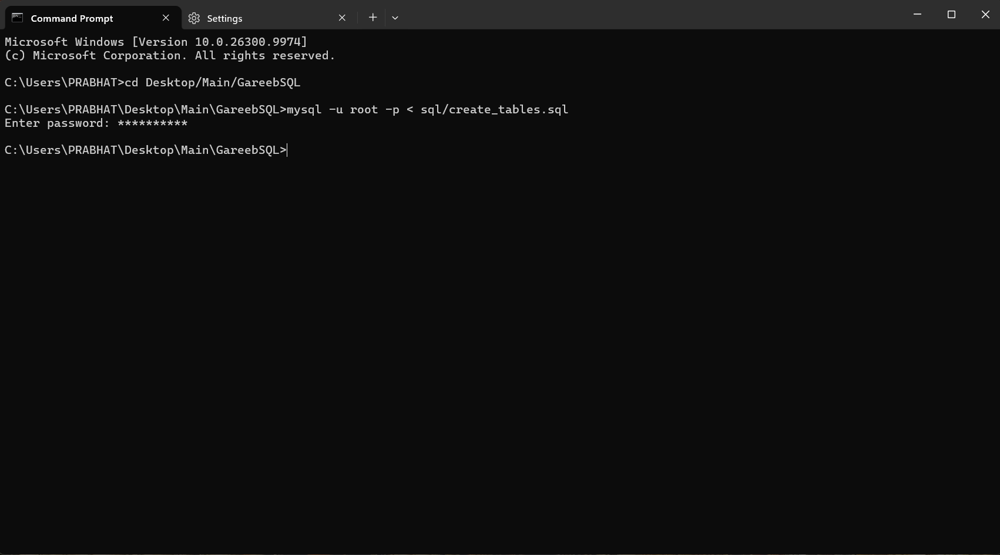

<h1 align="center">SQL Execution & Proof</h1>
<p align="center">Step-by-step execution of all SQL scripts in MySQL 8.0 with terminal screenshots.</p>

---

## 1. Create Tables (`create_tables.sql`)
**Run:**
```powershell
mysql -u root -p < sql/create_tables.sql
mysql -u root -p -e "USE gareeb_sql; SHOW TABLES;"
```
