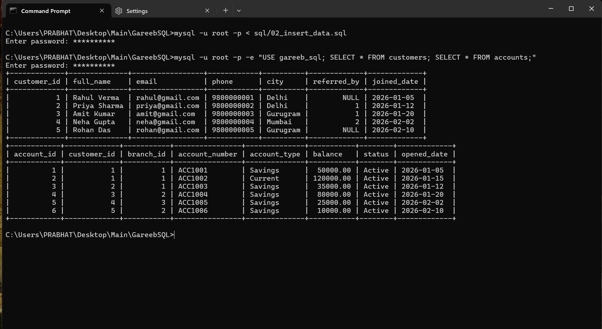
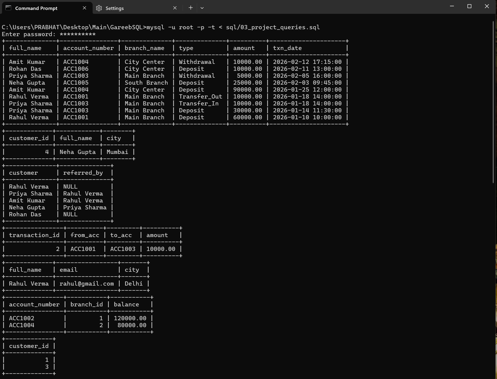
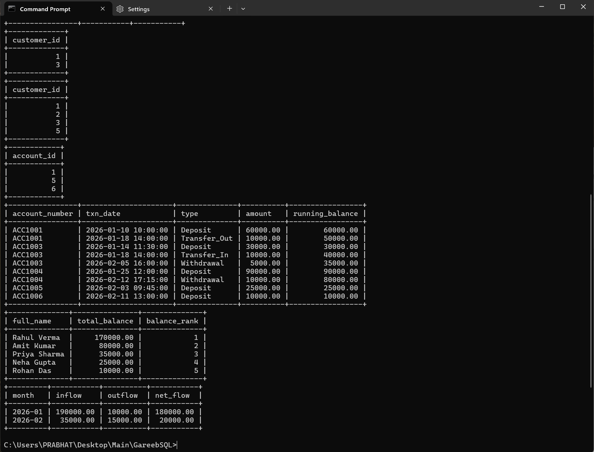
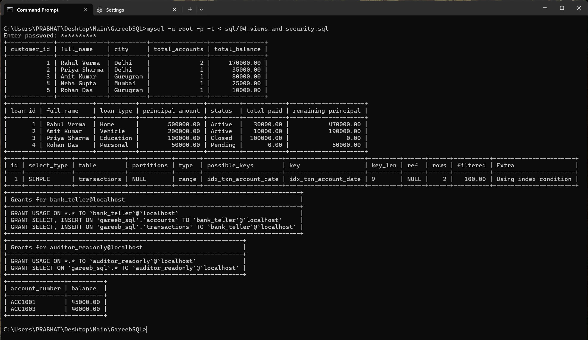

<h1 align="center">SQL Execution & Proof</h1>
<p align="center">Step-by-step execution of all SQL scripts in MySQL 8.0 with terminal screenshots.</p>

---

## 1. Create Tables (`01_create_tables.sql`)
**Run:**
```powershell
mysql -u root -p < sql/create_tables.sql
mysql -u root -p -e "USE gareeb_sql; SHOW TABLES;"
```


## 2. Insert Data (`02_insert_data.sql`)
**Run:**
```powershell
mysql -u root -p < sql/02_insert_data.sql
mysql -u root -p -e "USE gareeb_sql; SELECT * FROM customers; SELECT * FROM accounts;"
```


## 3. Core & Analytical Queries (`03_project_queries.sql`)
**Run:**
```powershell
mysql -u root -p -t < sql/03_project_queries.sql
```
<table>
  <tr>
    <td align="center">
      
    </td>
    <td align="center">
      
    </td>
  </tr>
</table>

## 4. Views and Security (`04_views_and_security.sql`)
**Run:**
```powershell
mysql -u root -p -t < sql/04_views_and_security.sql
```
